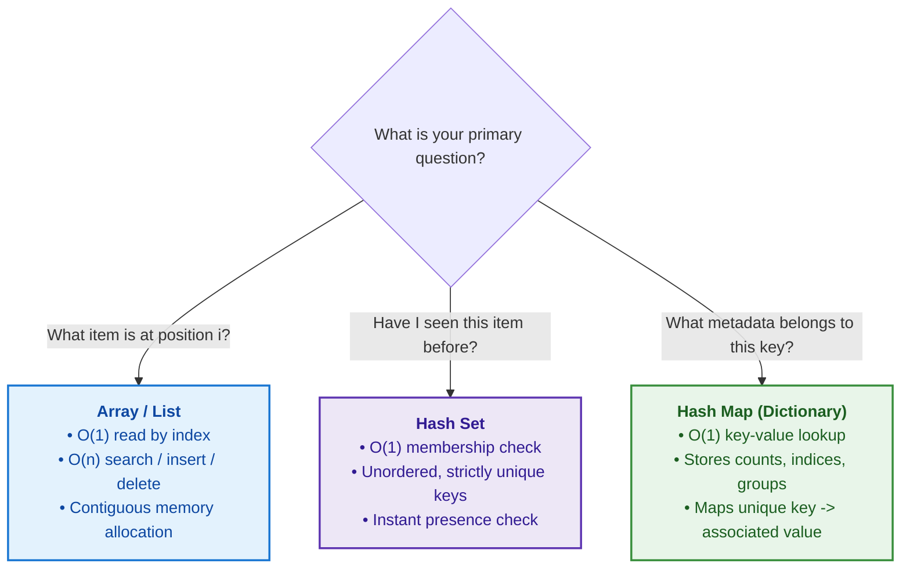
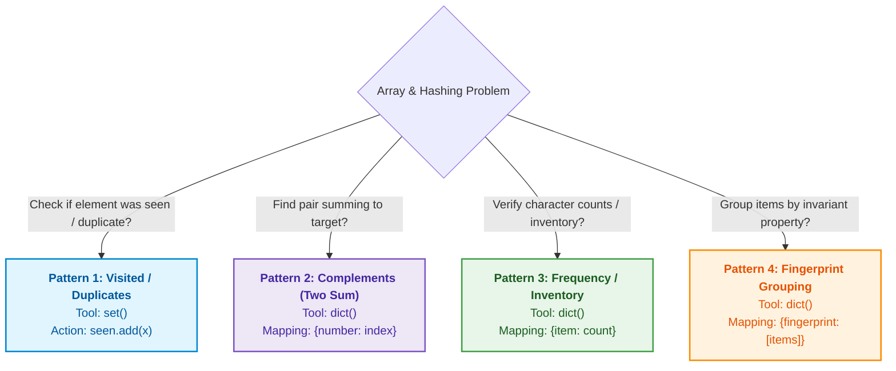
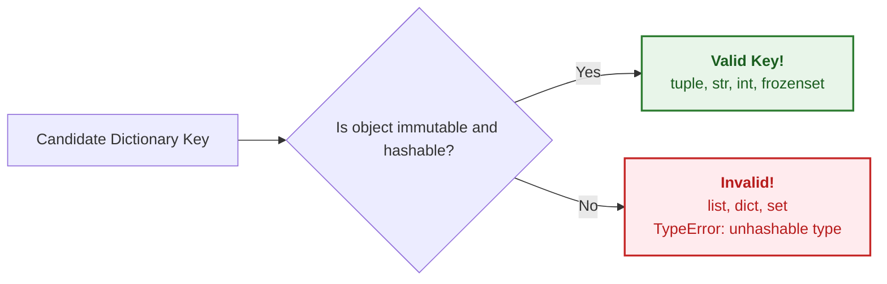
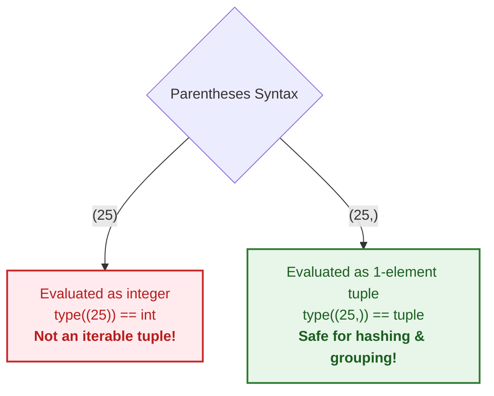
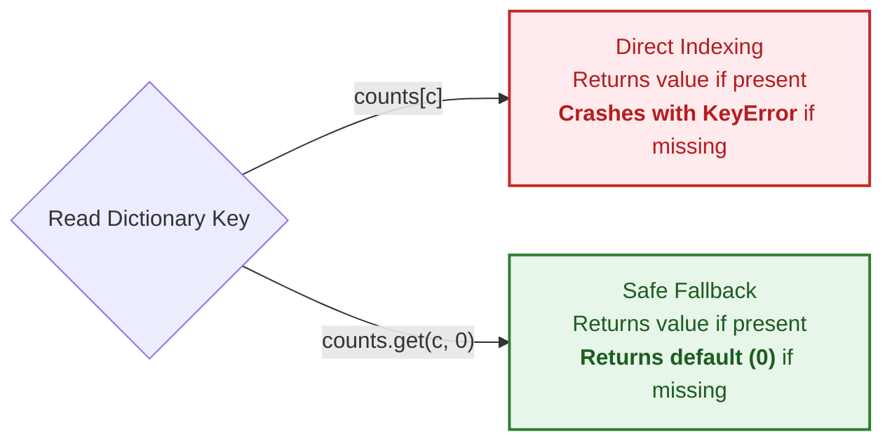
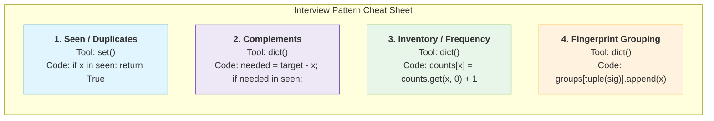

# Arrays and Hashing: Core Mental Models & Patterns

A foundational guide to solving Array and Hashing problems in technical interviews.

---

## 1. The 3 Core Tools

Understanding which data structure to choose begins by asking what question you need to answer.



---

### 1. Array (List)
* **How it works:** Elements are laid out side-by-side in contiguous memory blocks.
* **Memory Layout:**
  ```mermaid
  flowchart LR
      subgraph Memory["Contiguous Memory Layout"]
          A0["Index 0<br/>Base + 0*size<br/><b>nums[0]</b>"] --- A1["Index 1<br/>Base + 1*size<br/><b>nums[1]</b>"] --- A2["Index 2<br/>Base + 2*size<br/><b>nums[2]</b>"] --- A3["Index 3<br/>Base + 3*size<br/><b>nums[3]</b>"]
      end
      style Memory fill:#f5f5f5,stroke:#9e9e9e,stroke-width:1px
  ```
* **Strengths:** 
  * Instant random access: `a[i]` runs in $O(1)$ time because the computer calculates the exact memory location using:
    $$\text{Address} = \text{Base Address} + (i \times \text{Element Size})$$
* **Weaknesses:**
  * Searching for an arbitrary value takes $O(n)$ time (must scan element by element).
  * Inserting or deleting elements in the middle requires shifting trailing elements, costing $O(n)$ time.

---

### 2. Hash Set
* **How it works:** An unordered collection containing only unique keys (no values). It hashes items to bucket locations.
* **Core Question:** *"Have I seen this item before?"*
* **Strengths:** Instant $O(1)$ average time complexity for:
  * Lookups: `item in seen`
  * Insertions: `seen.add(item)`
  * Deletions: `seen.remove(item)`

---

### 3. Hash Map (Dictionary)
* **How it works:** Stores key-value mappings (`key -> value`). Every key is unique and hashed to find its associated value.
* **Core Question:** *"What information belongs to this key?"*
* **Common Values Stored:**
  * **Occurrences:** `{item: count}` (Frequency counting)
  * **Previous Index:** `{number: index}` (Complements / Two Sum)
  * **Grouped Collections:** `{fingerprint: [items]}` (Bucketing / Anagram grouping)

---

### Comparison Matrix

| Feature | Array / List (`list`) | Hash Set (`set`) | Hash Map (`dict`) |
| :--- | :--- | :--- | :--- |
| **Data Stored** | Ordered sequence of items | Unique, unordered keys | Unique keys $\to$ mapped values |
| **Primary Question** | *"Give me the item at position $i$"* | *"Have I seen this item before?"* | *"What data is mapped to this key?"* |
| **Lookup by Index/Key** | $O(1)$ by index | $O(1)$ membership (`x in s`) | $O(1)$ key lookup (`d[k]`) |
| **Lookup by Value** | $O(n)$ linear scan | N/A (keys are the values) | $O(n)$ searching values |
| **Insertion / Deletion** | $O(n)$ at arbitrary index | $O(1)$ average | $O(1)$ average |
| **Duplicates Allowed?** | Yes | No (strictly unique) | Keys: No / Values: Yes |

---

## 2. The 4 Classic Interview Patterns

Most array and hashing interview problems boil down to one of these four algorithmic blueprints:



---

### Pattern 1: Check for Duplicates / Visited Items

* **Tool:** `set`
* **When to use:** Detecting cycles, identifying first duplicate, finding visited nodes or seen values.
* **Process Flow:**
  ```mermaid
  flowchart LR
      Start["Element: item"] --> Check{"item in seen?"}
      Check -->|"Yes"| Dup["<b>Duplicate Found!</b><br/>return True"]
      Check -->|"No"| Add["Add to Set:<br/>seen.add(item)"]
      Add --> Next["Continue to next item"]

      style Dup fill:#ffebee,stroke:#c62828,stroke-width:2px,color:#b71c1c
      style Add fill:#e8f5e9,stroke:#2e7d32,stroke-width:2px,color:#1b5e20
  ```
* **Core Code Shape:**
  ```python
  seen = set()
  for item in items:
      if item in seen:
          return True
      seen.add(item)
  return False
  ```
* **Concrete Example:** [ContainsDuplicate.py](file:///c:/Users/prave/Softwares/FAANG%20DSA/Hashing/ContainsDuplicate.py)
  ```python
  def contains_duplicate(nums: list[int]) -> bool:
      seen = set()
      for num in nums:
          if num in seen:
              return True
          seen.add(num)
      return False
  ```
* **Complexity:**
  * **Time:** $O(n)$ — single pass over the list.
  * **Space:** $O(n)$ — stores up to $n$ elements in the set.

---

### Pattern 2: Find Complements (Two Sum)

* **Tool:** `dict` storing `{number: index}`
* **When to use:** Looking for pairs that satisfy a mathematical relation (e.g., $A + B = \text{target}$, $A - B = k$).
* **Process Flow:**
  ```mermaid
  flowchart TD
      Current["Read num at index idx"] --> Calc["Calculate complement:<br/>needed = target - num"]
      Calc --> Check{"needed in seen?"}
      Check -->|"Yes (Match Found!)"| Return["<b>Return:</b><br/>[seen[needed], idx]"]
      Check -->|"No"| Store["Record current:<br/>seen[num] = idx"]
      Store --> Next["Move to next index"]

      style Return fill:#e8f5e9,stroke:#2e7d32,stroke-width:2px,color:#1b5e20
      style Store fill:#e3f2fd,stroke:#1565c0,stroke-width:2px,color:#0d47a1
  ```
* **Core Code Shape:**
  ```python
  seen = {}  # maps number -> index
  for idx, current in enumerate(nums):
      needed = target - current
      if needed in seen:
          return [seen[needed], idx]
      seen[current] = idx
  ```
* **Why this works in One Pass:**
  * As you iterate forward, each element looks backward into `seen` to see if its complement has already arrived.
  * You record the current element *after* checking, which naturally prevents using the same element twice.
* **Concrete Example:** [TwoSum.py](file:///c:/Users/prave/Softwares/FAANG%20DSA/Hashing/TwoSum.py)
  ```python
  def two_sum(nums: list[int], target: int) -> list[int]:
      seen = {}
      for idx, num in enumerate(nums):
          complement = target - num
          if complement in seen:
              return [seen[complement], idx]
          seen[num] = idx
      return []
  ```
* **Complexity:**
  * **Time:** $O(n)$ — each lookup in `seen` is $O(1)$.
  * **Space:** $O(n)$ — dictionary holds up to $n$ entries.

---

### Pattern 3: Frequency Counting / Inventory (Anagrams, Ransom Note)

* **Tool:** `dict` storing `{item: count}`
* **When to use:** Verifying anagrams, checking character allowances (ransom notes), tracking frequencies, finding top $K$ frequent elements.
* **Process Flow:**
  ```mermaid
  flowchart TD
      subgraph Phase1["Phase 1: Build Inventory (Source)"]
          P1_Read["For each character c in Source"] --> P1_Inc["counts[c] = counts.get(c, 0) + 1"]
      end

      subgraph Phase2["Phase 2: Consume Inventory (Target)"]
          P2_Read["For each character c in Target"] --> P2_Check{"c not in counts<br/>OR counts[c] == 0?"}
          P2_Check -->|"Yes (Insufficient)"| P2_Fail["<b>Invalid!</b><br/>return False"]
          P2_Check -->|"No (Available)"| P2_Dec["counts[c] -= 1"]
      end

      Phase1 --> Phase2
      P2_Dec --> Done["<b>Success!</b><br/>All characters matched -> return True"]

      style P2_Fail fill:#ffebee,stroke:#c62828,stroke-width:2px,color:#b71c1c
      style Done fill:#e8f5e9,stroke:#2e7d32,stroke-width:2px,color:#1b5e20
  ```
* **Core Code Shape:**
  ```python
  # 1. Build inventory
  counts = {}
  for item in source:
      counts[item] = counts.get(item, 0) + 1

  # 2. Consume / verify inventory
  for item in target:
      if counts.get(item, 0) <= 0:
          return False
      counts[item] -= 1
  ```
* **Concrete Examples:**
  * **Ransom Note** ([ransomnote.py](file:///c:/Users/prave/Softwares/FAANG%20DSA/Hashing/ransomnote.py)):
    ```python
    def can_construct(ransom_note: str, magazine: str) -> bool:
        if len(ransom_note) > len(magazine):
            return False

        counts = {}
        for char in magazine:
            counts[char] = counts.get(char, 0) + 1

        for char in ransom_note:
            if char not in counts or counts[char] == 0:
                return False
            counts[char] -= 1

        return True
    ```
  * **Valid Anagram** ([ValidAnagrams.py](file:///c:/Users/prave/Softwares/FAANG%20DSA/Hashing/ValidAnagrams.py)):
    ```python
    def is_anagram(s: str, t: str) -> bool:
        if len(s) != len(t):
            return False

        counts = {}
        for char in s:
            counts[char] = counts.get(char, 0) + 1
        for char in t:
            if char not in counts or counts[char] == 0:
                return False
            counts[char] -= 1

        return True
    ```
* **Complexity:**
  * **Time:** $O(n)$ where $n$ is string/list length.
  * **Space:** $O(k)$ where $k$ is the number of distinct characters ($O(1)$ if alphabet size is bounded to 26 letters).

---

### Pattern 4: Fingerprint Grouping (Group Anagrams, Shifted Strings)

* **Tool:** `dict` storing `{fingerprint: [items]}`
* **When to use:** Partitioning collections of items into groups that share an invariant property (canonical form).
* **Process Flow:**
  ```mermaid
  flowchart LR
      Input["Input Items<br/>['eat', 'tea', 'tan', 'ate', 'nat', 'bat']"] --> Loop["Iterate Items"]
      
      Loop --> FP["Compute Fingerprint<br/>Sorted: 'aet'<br/>OR Count: (1,0,...,1,...)"]
      
      FP --> Group{"Fingerprint in groups?"}
      Group -->|"No"| Init["groups[fp] = []"] --> Append["groups[fp].append(item)"]
      Group -->|"Yes"| Append
      
      Append --> Output["<b>Return:</b><br/>list(groups.values())"]

      style Input fill:#f5f5f5,stroke:#757575,stroke-width:1px
      style FP fill:#fff3e0,stroke:#fb8c00,stroke-width:2px,color:#e65100
      style Output fill:#e8f5e9,stroke:#2e7d32,stroke-width:2px,color:#1b5e20
  ```
* **Core Code Shape:**
  ```python
  groups = {}
  for item in items:
      fingerprint = compute_fingerprint(item)  # Must be an immutable type (tuple or string)
      if fingerprint not in groups:
          groups[fingerprint] = []
      groups[fingerprint].append(item)

  return list(groups.values())
  ```
* **Two Popular Fingerprint Strategies:**

  #### Strategy A: Sorted Signature
  For anagrams, sorting the characters produces the exact same string for all words in the same group.
  ```python
  def group_anagrams_sorted(strs: list[str]) -> list[list[str]]:
      groups = {}
      for s in strs:
          key = "".join(sorted(s))  # e.g., "eat" -> "aet"
          if key not in groups:
              groups[key] = []
          groups[key].append(s)
      return list(groups.values())
  ```
  * *Cost per word:* $O(L \log L)$ where $L$ is word length.

  #### Strategy B: Character Count Tuple ($O(L)$ Signature)
  Count occurrences of all 26 lowercase English letters and use the count array as an immutable `tuple` key.
  ```python
  def group_anagrams_count(strs: list[str]) -> list[list[str]]:
      groups = {}
      for s in strs:
          count = [0] * 26
          for char in s:
              count[ord(char) - ord('a')] += 1
          
          # Lists cannot be keys; convert to tuple!
          key = tuple(count)
          if key not in groups:
              groups[key] = []
          groups[key].append(s)
      return list(groups.values())
  ```

  #### Strategy C: Difference Fingerprint (Shifted Strings)
  For strings shifted by uniform cyclic offsets (e.g., `"abc"` and `"bcd"`):
  ```python
  def get_shifted_fingerprint(s: str) -> tuple[int, ...]:
      diffs = []
      for i in range(len(s) - 1):
          diff = (ord(s[i + 1]) - ord(s[i])) % 26
          diffs.append(diff)
      return tuple(diffs)
  ```

---

## 3. 3 Python Rules to Remember

### Rule 1: Lists Cannot Be Dictionary Keys
In Python, dictionary keys must be **hashable**. An object is hashable only if its value never changes during its lifetime (immutable).



* `list` is mutable (you can `.append()`, modify in-place), so Python cannot compute a fixed hash code.
* Trying to use a list as a key raises `TypeError: unhashable type: 'list'`.
* **Fix:** Convert mutable lists to an immutable `tuple`:
  ```python
  diff_list = [1, 2, 3]

  # WRONG:
  # seen[diff_list] = True  # Raises TypeError: unhashable type: 'list'

  # CORRECT:
  key = tuple(diff_list)
  seen[key] = True
  ```

---

### Rule 2: Single-Element Tuples Need a Trailing Comma
Parentheses `(...)` are used for both grouping mathematical expressions and defining tuples. Without a trailing comma, Python treats parentheses as standard expression grouping.



```python
x = (25)
print(type(x))  # <class 'int'> -> Unpack or iteration bugs will occur!

y = (25,)
print(type(y))  # <class 'tuple'> -> Correct!
```

> [!WARNING]
> If your fingerprinting function computes differences and returns a single value for 2-character strings, returning `(diff)` returns an `int` rather than a `tuple`, causing type mismatch bugs when grouping. Always ensure 1-element tuples include a trailing comma `(diff,)`.

---

### Rule 3: Safe Dictionary Reads with `.get()`
Accessing a missing key using standard bracket notation `d[key]` raises an unhandled `KeyError` that crashes your program.



```python
counts = {}

# UNSAFE:
# counts[char] += 1  # Raises KeyError if char is seen for the first time

# SAFE:
counts[char] = counts.get(char, 0) + 1
```

Alternatively, you can use Python's built-in `defaultdict`:
```python
from collections import defaultdict

counts = defaultdict(int)
counts[char] += 1  # Automatically initializes missing keys to 0
```

---

## 4. Quick Reference Summary


