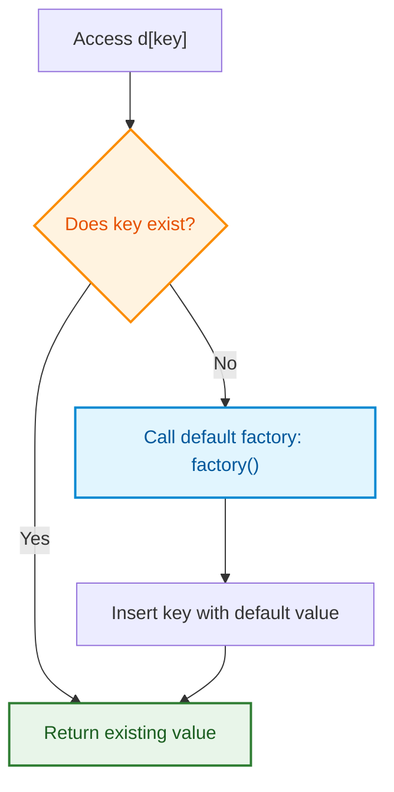
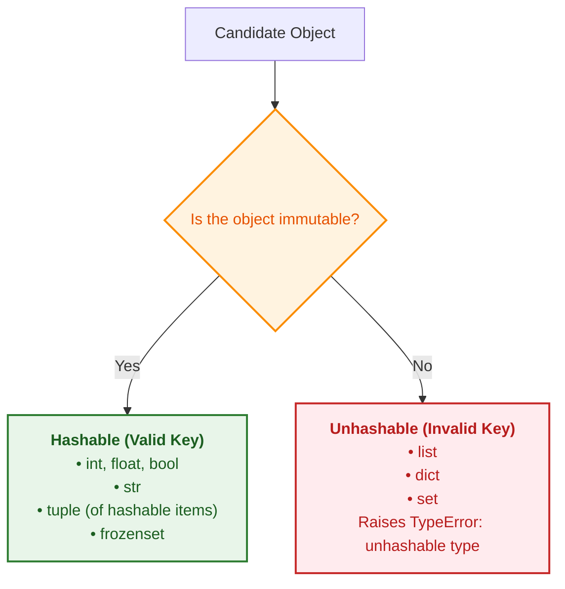

# Python Core Functions & Concepts Reference

A generalized, concept-first guide to Python built-in functions, methods, and data structures commonly used in hashing, collections, and interview problems.

---

## 1. `collections.defaultdict`

### What It Is
A subclass of Python's built-in `dict`. When you request a key that does not exist, `defaultdict` automatically creates the key and assigns it a default value produced by a **factory function**, instead of raising a `KeyError`.

### How It Works (Flowchart)



### Generalized Examples

#### A. Grouping items with `defaultdict(list)`
```python
from collections import defaultdict

# Group people by city
people_by_city = defaultdict(list)

people = [("Alice", "New York"), ("Bob", "Chicago"), ("Charlie", "New York")]

for name, city in people:
  people_by_city[city].append(name)

# Result:
# {'New York': ['Alice', 'Charlie'], 'Chicago': ['Bob']}
```

#### B. Counting occurrences with `defaultdict(int)`
```python
# Count word frequencies (int() returns 0 by default)
word_counts = defaultdict(int)

words = ["apple", "banana", "apple", "orange", "banana", "apple"]
for word in words:
  word_counts[word] += 1

# Result:
# {'apple': 3, 'banana': 2, 'orange': 1}
```

#### C. Storing unique items with `defaultdict(set)`
```python
# Track unique tags per user
user_tags = defaultdict(set)

user_tags["user_1"].add("python")
user_tags["user_1"].add("ai")
user_tags["user_1"].add("python")  # Duplicate ignored

# Result:
# {'user_1': {'python', 'ai'}}
```

> **Key Rule:** Pass the callable function name (`list`, `int`, `set`), **not** an invoked function call like `list()`.

---

## 2. `sorted(iterable, key=..., reverse=...)`

### What It Is
A built-in function that takes any iterable and returns a **new sorted list** containing all its items in ascending order. It does **not** modify the original iterable.

### Key Characteristics
* **Algorithm:** Timsort ($\mathcal{O}(n \log n)$ time complexity).
* **Return Type:** Always a `list`, regardless of the input type.

### Generalized Examples

```python
# 1. Sorting a string (returns a list of characters)
sorted("python")
# Output: ['h', 'n', 'o', 'p', 't', 'y']

# 2. Sorting numbers
sorted([42, 10, 5, 88])
# Output: [5, 10, 42, 88]

# 3. Sorting with reverse=True
sorted([42, 10, 5, 88], reverse=True)
# Output: [88, 42, 10, 5]

# 4. Sorting with a custom key (by length)
names = ["elephant", "cat", "dog", "giraffe"]
sorted(names, key=len)
# Output: ['cat', 'dog', 'giraffe', 'elephant']
```

> **Important Distinction:** `list.sort()` sorts a list **in-place** and returns `None`. `sorted(iterable)` works on **any** iterable (strings, tuples, sets, dicts) and returns a **new list**.

---

## 3. `str.join(iterable)`

### What It Is
A string method that concatenates elements of an iterable into a single string, using the caller string as the delimiter.

### Syntax
```python
"delimiter".join(iterable_of_strings)
```

### Generalized Examples

```python
# 1. Joining with an empty separator (no spaces)
letters = ["p", "y", "t", "h", "o", "n"]
word = "".join(letters)
# Output: "python"

# 2. Joining with a hyphen (formatting dates, slugs)
date_parts = ["2026", "10", "23"]
formatted_date = "-".join(date_parts)
# Output: "2026-10-23"

# 3. Joining with comma and space (creating human-readable lists)
fruits = ["apple", "banana", "cherry"]
text = ", ".join(fruits)
# Output: "apple, banana, cherry"
```

### Common Gotcha
All elements in the iterable **must** be strings. If you have integers or mixed types, convert them first:
```python
numbers = [1, 2, 3, 4]
# WRONG: "-".join(numbers) -> TypeError: sequence item 0: expected str instance, int found

# CORRECT: Convert items to strings using a comprehension or map()
result = "-".join(map(str, numbers))
# Output: "1-2-3-4"
```

---

## 4. Hashability & Mutability in Python

### What It Is
A dictionary (`dict`) and set (`set`) rely on **hash tables** for $\mathcal{O}(1)$ average lookups. For an object to be used as a dictionary key or stored in a set, it must be **hashable**.

An object is hashable if:
1. It has a hash value that never changes during its lifetime (implements `__hash__()`).
2. It can be compared to other objects for equality (implements `__eq__()`).

### Hashability Decision (Flowchart)



### Generalized Examples

```python
# Valid keys (immutable):
valid_dict = {}
valid_dict["user_id"] = 101  # String key -> OK
valid_dict[42] = "answer"  # Integer key -> OK
valid_dict[(10, 20)] = "coordinate"  # Tuple key -> OK

# Invalid keys (mutable):
invalid_dict = {}
# invalid_dict[[10, 20]] = "coordinate"
# Raises: TypeError: unhashable type: 'list'

# invalid_dict[{"a": 1}] = "metadata"
# Raises: TypeError: unhashable type: 'dict'
```

---

## 5. `dict.values()` vs `list()`

### What They Are
* `dict.values()` returns a **dictionary view object** containing the dictionary's values.
* `list(iterable)` casts any iterable (including view objects) into an explicit `list`.

### Key Differences

| Feature | `dict.values()` | `list(dict.values())` |
| :--- | :--- | :--- |
| **Type** | `dict_values` view | `list` |
| **Memory** | $\mathcal{O}(1)$ (does not duplicate data) | $\mathcal{O}(n)$ (allocates a new list) |
| **Dynamic?** | Yes (reflects changes to the dictionary) | No (static snapshot) |
| **Indexable?** | No (`view[0]` raises `TypeError`) | Yes (`lst[0]` works) |

### Generalized Examples

```python
grades = {"Alice": 95, "Bob": 82, "Charlie": 90}

# 1. Getting a view:
values_view = grades.values()
# Output: dict_values([95, 82, 90])

# 2. View is dynamic:
grades["David"] = 88
print(values_view)
# Output: dict_values([95, 82, 90, 88])  <- Automatically updated!

# 3. Converting to a concrete list (required for indexing or specific return types):
values_list = list(grades.values())
# Output: [95, 82, 90, 88]
first_score = values_list[0]  # Valid: 95
```

---

## 6. `ord()` and `chr()`

### What They Are
Functions for translating between characters and their Unicode integer code points.

* `ord(char)`: Returns the integer representing the character.
* `chr(integer)`: Returns the character corresponding to the integer code point.

### Generalized Examples

```python
# 1. Inspecting Unicode values:
print(ord("a"))  # 97
print(ord("b"))  # 98
print(ord("z"))  # 122

print(ord("A"))  # 65
print(ord("0"))  # 48

# 2. Converting back from integer to character:
print(chr(97))  # 'a'
print(chr(65))  # 'A'

# 3. Normalizing characters to 0-based index (0 to 25):
letter = "c"
index = ord(letter) - ord("a")
# index = 99 - 97 = 2
```

---

## 7. `tuple(iterable)`

### What It Is
Takes any iterable and creates an **immutable sequence** (`tuple`).

### Why It Is Used in Hashing & Caching
Because lists are mutable, they cannot be hashed or stored in sets / dictionary keys. Converting a list into a `tuple` freezes its contents and makes it hashable.

### Generalized Examples

```python
# 1. Freezing coordinates for a graph/grid path:
current_pos = [3, 4]  # Mutable list
visited = set()

# visited.add(current_pos)        # FAILS: TypeError: unhashable type: 'list'
visited.add(tuple(current_pos))  # SUCCESS: stores (3, 4)

# 2. Using fixed frequencies as cache keys:
frequency_list = [0] * 26
frequency_list[0] = 2  # 'a' appears twice
frequency_list[2] = 1  # 'c' appears once

cache = {}
cache[tuple(frequency_list)] = "computed_result"  # Valid hashable key
```

---

## Quick Reference Summary

| Function / Method | Primary Purpose | Return Type | Mutates Original? |
| :--- | :--- | :--- | :--- |
| `defaultdict(factory)` | Dict that auto-creates missing keys with default values | `defaultdict` | N/A |
| `sorted(iterable)` | Sorts elements in ascending/custom order | `list` | No |
| `str.join(iterable)` | Concatenates iterable of strings with a delimiter | `str` | No |
| `dict.values()` | Dynamic view of dictionary values | `dict_values` | No |
| `list(iterable)` | Creates a new list from an iterable/view | `list` | No |
| `ord(char)` | Gets integer code point of a character | `int` | No |
| `chr(int)` | Gets character from integer code point | `str` | No |
| `tuple(iterable)` | Freezes an iterable into an immutable, hashable sequence | `tuple` | No |
