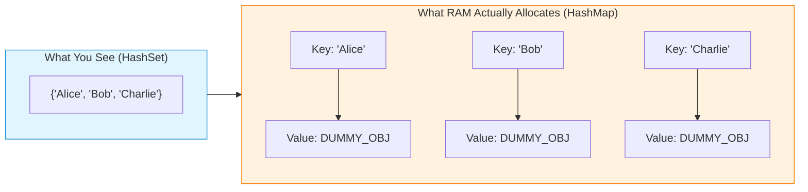
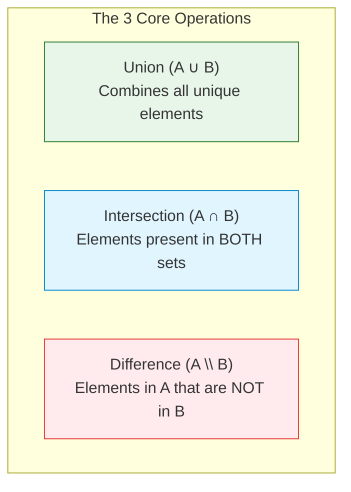
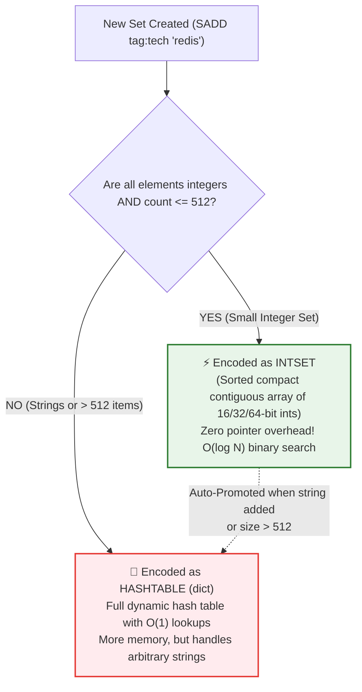

# Sets & HashSets: Complete FAANG Interview & Systems Architecture Guide 🎯

A comprehensive, visual guide to **Sets, HashSets, and Mathematical Set Operations** — from internal hash bucket mechanics and mutual-friend graph intersections to how Redis optimizes small sets using `intset`.

---

## 🧭 Document Navigation

```
Sets_and_HashSets_Guide/
├── 1. 🧠 Core Mental Model: The Mathematical Set
├── 2. ⚙️ How HashSets Work Under the Hood (The HashMap Disguise)
├── 3. 🎯 The 3 Master Set Operations & Real-World Use Cases
│   ├── Union (A ∪ B)
│   ├── Intersection (A ∩ B) - Finding Mutual Friends
│   └── Difference (A \ B) - Unreached Users
├── 4. 📊 HashSet vs. TreeSet vs. BitSet Comparison
├── 5. 🚀 Real-World Systems Connection: How Redis Implements `SET`
│   ├── The Memory Optimization: `intset` (Packed Integer Array)
│   ├── Dynamic Promotion to Hash Table (`dict`)
│   └── Planetary-Scale Cardinality: HyperLogLog & Bitmaps
```

---

## 🧠 1. Core Mental Model: The Mathematical Set

In computer science, a **Set** is an abstract data collection that enforces two fundamental laws:
1. **Uniqueness:** No duplicate elements are permitted. Inserting an element that already exists is a safe NO-OP.
2. **Membership Testing:** Designed to answer one question instantly: **"Does element $X$ exist in the collection?"**

```
+-------------------------------------------------------------------------+
|                  MEMBERSHIP TEST: ARRAY VS. HASH SET                    |
+-------------------------------------------------------------------------+
|  Array / List: [ "apple", "banana", "cherry", ... "mango" ]             |
|  • "Is 'mango' in the array?"                                           |
|  • Must scan elements one by one from left to right: O(N) Time 🐢       |
|                                                                         |
|  Hash Set: { "apple", "banana", "cherry", ... "mango" }                 |
|  • "Is 'mango' in the set?"                                             |
|  • Hash("mango") -> Direct Bucket Index -> O(1) Instant Lookup! ⚡      |
+-------------------------------------------------------------------------+
```

---

## ⚙️ 2. How HashSets Work Under the Hood (The HashMap Disguise)

Every software engineer must understand this insider truth:

> **A HashSet is NOT a unique data structure.**  
> **A HashSet is simply a HashMap under the hood, where the Set elements are stored as Keys, and the Values are ignored dummy placeholders!**

### Java's Internal Implementation (`java.util.HashSet`):
```java
public class HashSet<E> {
    // 1. The backing HashMap
    private transient HashMap<E, Object> map;

    // 2. A single dummy constant object used for all keys
    private static final Object PRESENT = new Object();

    public boolean add(E e) {
        // Puts the element as the KEY; uses PRESENT as the dummy value
        return map.put(e, PRESENT) == null;
    }

    public boolean contains(Object o) {
        return map.containsKey(o); // O(1) Key Lookup!
    }
}
```



---

## 🎯 3. The 3 Master Set Operations & Real-World Use Cases

In FAANG interviews and production systems (Redis `SINTER`, `SUNION`, `SDIFF`), sets are used to perform high-speed relational algebra:



### 1. Intersection ($A \cap B$): Finding Mutual Friends at Meta/Instagram 👥
* **Problem:** Given User 1's following list and User 2's following list, find their common friends.
* **Algorithm:** Loop through the smaller set; check membership in the larger set:
  $$\mathcal{O}(\min(|A|, |B|))$$
* **Redis Command:** `SINTER user:101:friends user:202:friends`

### 2. Difference ($A \setminus B$): Targeted Marketing & Unreached Users 🎯
* **Problem:** Find all registered customers ($A$) who have **not** yet purchased a subscription ($B$).
* **Redis Command:** `SDIFF all_registered_users subscribed_users`

### 3. Union ($A \cup B$): Deduplicating Visitor Logs 📊
* **Problem:** Combine website visitors from mobile apps and desktop browsers to calculate total unique reach.
* **Redis Command:** `SUNION mobile_visitors desktop_visitors`

---

## 📊 4. HashSet vs. TreeSet vs. BitSet Comparison

| Feature | HashSet | TreeSet (Sorted Set) | BitSet / Bitmap |
| :--- | :--- | :--- | :--- |
| **Backing Structure** | Hash Table (Array + Buckets) | Red-Black Tree (Balanced BST) | Contiguous Bit Array |
| **Element Ordering** | ❌ **Unordered** (Pseudo-random) | 🔢 **Strictly Sorted** ($1, 2, 3..$) | 🔢 **Indexed by Integer Bit** |
| **Lookup Time** | ⚡ $\mathcal{O}(1)$ average | ⚡ $\mathcal{O}(\log N)$ guaranteed | ⚡ $\mathcal{O}(1)$ bitwise lookup |
| **Insert / Delete** | ⚡ $\mathcal{O}(1)$ average | ⚡ $\mathcal{O}(\log N)$ | ⚡ $\mathcal{O}(1)$ |
| **Range Queries** | ❌ Impossible ($\mathcal{O}(N)$ scan) | ✅ $\mathcal{O}(\log N + K)$ range scan | ✅ Bitwise AND/OR scans |
| **Memory Cost** | Medium ($\approx 32\text{ bytes/entry}$) | High ($\approx 48\text{ bytes/entry}$) | 🟢 **Ultra-low (1 bit per entry!)** |

---

## 🚀 5. Real-World Systems Connection: How Redis Implements `SET`

In Redis, commands like `SADD`, `SMEMBERS`, and `SISMEMBER` power high-concurrency tags, unique visitors, and permissions. 

Redis uses **adaptive internal encoding** to minimize memory consumption:



### The `intset` Memory Miracle:
If you store $500$ user IDs (`101`, `102`, `103`...):
* A regular C hash table requires **$\approx 16\text{ KB}$ of RAM** (hash buckets, pointers, collision chains).
* An **`intset`** stores all 500 integers in a single contiguous byte buffer:
  $$500 \times 4\text{ bytes} = \mathbf{2\text{ KB of RAM}}\quad (\mathbf{87.5\%\text{ memory savings!}})$$
* Membership lookups use blazing-fast **binary search ($O(\log N)$)** which fits entirely inside the CPU's **L1/L2 Cache Line**!
