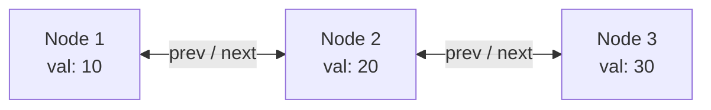
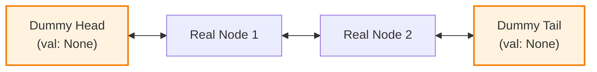
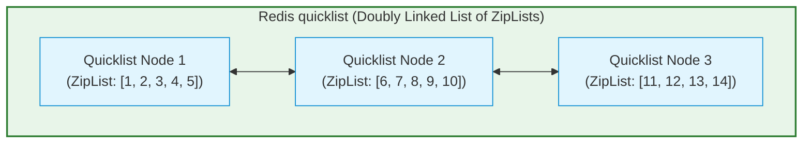

# Linked Lists: Complete FAANG Interview & Engineering Guide 🔗

An exhaustive, visual, and mathematically rigorous guide to **Linked Lists** — from memory layout trade-offs and two-pointer algorithms to the sentinel node technique and how Redis uses `quicklist` under the hood.

---

## 🧭 Document Navigation

```
LinkedList_Guide/
├── 1. 🧠 Core Mental Model: The Memory Treasure Hunt
├── 2. ⚡ Physical RAM Layout: Array vs. Linked List (The Cache Penalty)
├── 3. 🧱 The 3 Variations of Linked Lists
│   ├── Singly Linked List
│   ├── Doubly Linked List (O(1) Self-Removal)
│   └── Circular Linked List
├── 4. 📊 Big-O Complexity Comparison Matrix
├── 5. 🛡️ The Sentinel Node Pattern (Dummy Head & Tail)
├── 6. 🎯 Classic FAANG Interview Patterns
│   ├── Pattern A: Fast & Slow Pointers (Floyd's Cycle Detection)
│   ├── Pattern B: Finding the Middle Node & K-th from End
│   └── Pattern C: In-Place Reversal (The 3-Pointer Dance)
└── 7. 🚀 Real-World Systems Connection: How Redis Uses Linked Lists
    ├── The Classic Doubly Linked List (`adlist`)
    ├── The Memory Problem: Pointer Bloat & Fragmentation
    └── The Production Solution: `quicklist` (Linked List of ZipLists)
```

---

## 🧠 1. Core Mental Model: The Memory Treasure Hunt

Imagine an Array vs. a Linked List as two different ways to organize books in a library:

* **An Array is an Assigned Shelf:** Elements are packed back-to-back in consecutive memory addresses: `[0x100, 0x104, 0x108, 0x10C]`. If you know the index $i$, you immediately calculate the exact memory location: $\text{Address} = \text{Base} + (i \times \text{size})$. You reach for the shelf and grab it in $O(1)$ time.
* **A Linked List is a Treasure Hunt:** Each item is stored in a completely random location anywhere in RAM. The only way to find item #2 is by reading the "clue" (pointer/memory address) written on item #1:

```
[ Head: 0x500 ]
      │
      ▼
┌──────────────┐       ┌──────────────┐       ┌──────────────┐
│ Val: 10      │       │ Val: 20      │       │ Val: 30      │
│ Next: 0x920  │ ───►  │ Next: 0x140  │ ───►  │ Next: NULL   │
└──────────────┘       └──────────────┘       └──────────────┘
 (at RAM 0x500)         (at RAM 0x920)         (at RAM 0x140)
```

> **The Fundamental Trade-off:**  
> * **Arrays:** Instant $O(1)$ random access, but rigid contiguous memory allocation. Resizing requires re-allocating and copying the entire array.  
> * **Linked Lists:** Dynamic sizing and $O(1)$ insertion/deletion (once you have the pointer), but $O(N)$ sequential traversal.

---

## ⚡ 2. Physical RAM Layout: Array vs. Linked List (The Cache Penalty)

In software interviews, candidates often say: *"Linked List insertion is $O(1)$, so it's always faster than an Array for insertions."*  
**At FAANG, senior engineers know this is frequently false in hardware!**

```
+---------------------------------------------------------------------------------------+
|                      ARRAY: CONTIGUOUS MEMORY (CACHE FRIENDLY)                        |
+---------------------------------------------------------------------------------------+
|  RAM: [ Node 0 | Node 1 | Node 2 | Node 3 | Node 4 | Node 5 | ... ]                   |
|                                                                                       |
|  • When CPU loads Node 0, the hardware prefetcher loads a 64-byte Cache Line.         |
|  • Nodes 1, 2, and 3 are ALREADY inside CPU L1 Cache!                                 |
|  • Access time for subsequent nodes: ~0.5 to 1 nanosecond (99% L1 Cache Hit).          |
+---------------------------------------------------------------------------------------+

+---------------------------------------------------------------------------------------+
|                   LINKED LIST: SCATTERED HEAP MEMORY (CACHE HOSTILE)                  |
+---------------------------------------------------------------------------------------+
|  RAM: [ Node 0 ] ... (gap) ... [ Node 2 ] ... (gap) ... [ Node 1 ]                    |
|                                                                                       |
|  • Node 0 is at 0x1000. Node 1 is at 0x8500. Node 2 is at 0x3200.                     |
|  • Every pointer jump (`curr = curr.next`) forces a CPU Cache Miss.                   |
|  • The CPU must stall and wait ~80 to 100 nanoseconds to fetch from DRAM every node!   |
|  • Result: Traversing a 100,000-element Linked List can be 10x to 50x SLOWER          |
|    than traversing a 100,000-element Array, despite both being O(N) mathematically!    |
+---------------------------------------------------------------------------------------+
```

---

## 🧱 3. The 3 Variations of Linked Lists

### 1. Singly Linked List
Each node stores data and a single forward reference (`next`). Traversal is strictly forward.
```python
class ListNode:
    def __init__(self, val=0, next=None):
        self.val = val
        self.next = next
```

### 2. Doubly Linked List (DLL)
Each node stores data, a forward reference (`next`), and a backward reference (`prev`).
```python
class DoublyListNode:
    def __init__(self, val=0, prev=None, next=None):
        self.val = val
        self.prev = prev
        self.next = next
```



#### Why Doubly Linked Lists are Critical for FAANG Interviews:
* **$O(1)$ Self-Removal:** If you are handed a pointer to a node in a Singly Linked List, you *cannot* delete it in $O(1)$ without traversing from the head to find the predecessor.  
* In a Doubly Linked List, the node knows its predecessor:
  ```python
  def remove_node(node: DoublyListNode):
      node.prev.next = node.next
      node.next.prev = node.prev
  ```
  *(This is the exact backbone used in LRU Cache implementations!).*

### 3. Circular Linked List
The tail node's `next` pointer loops back to the head node (used in Round-Robin CPU scheduling).

---

## 📊 4. Big-O Complexity Comparison Matrix

| Operation | Array (Dynamic / ArrayList) | Singly Linked List | Doubly Linked List |
| :--- | :--- | :--- | :--- |
| **Access by Index ($[i]$)** | ⚡ $\mathcal{O}(1)$ | 🐢 $\mathcal{O}(N)$ | 🐢 $\mathcal{O}(N)$ |
| **Insert at Beginning (Head)** | 🐢 $\mathcal{O}(N)$ (shifts all) | ⚡ $\mathcal{O}(1)$ | ⚡ $\mathcal{O}(1)$ |
| **Insert at End (Tail with tail pointer)**| ⚡ $\mathcal{O}(1)$ amortized | ⚡ $\mathcal{O}(1)$ | ⚡ $\mathcal{O}(1)$ |
| **Delete at Beginning (Head)** | 🐢 $\mathcal{O}(N)$ (shifts all) | ⚡ $\mathcal{O}(1)$ | ⚡ $\mathcal{O}(1)$ |
| **Delete Given Node (pointer provided)**| 🐢 $\mathcal{O}(N)$ (search & shift) | 🐢 $\mathcal{O}(N)$ (needs parent) | ⚡ $\mathcal{O}(1)$ |
| **Memory Overhead Per Element** | 🟢 **Zero** (just the data) | 🟡 **8 Bytes** (1 pointer) | 🔴 **16 Bytes** (2 pointers) |

---

## 🛡️ 5. The Sentinel Node Pattern (Dummy Head & Tail)

In coding interviews, $90\%$ of candidate bugs in Linked List questions stem from edge cases:
* Inserting into an empty list.
* Deleting the head node (`head = head.next`).
* Deleting the tail node.

### The Solution: Sentinel (Dummy) Nodes
Introduce permanent, empty placeholder nodes at the boundaries:



```python
# Dummy nodes eliminate all "if head is None" or "if node == head" checks!
dummy_head = DoublyListNode(0)
dummy_tail = DoublyListNode(0)
dummy_head.next = dummy_tail
dummy_tail.prev = dummy_head

def add_to_front(node):
    node.next = dummy_head.next
    node.prev = dummy_head
    dummy_head.next.prev = node
    dummy_head.next = node
```

---

## 🎯 6. Classic FAANG Interview Patterns

### Pattern A: Fast & Slow Pointers (Floyd's Tortoise and Hare)
Used for **Cycle Detection** (LeetCode 141 & 142).
* **Slow pointer ($S$):** Moves 1 step at a time.
* **Fast pointer ($F$):** Moves 2 steps at a time.
* **Theorem:** If there is a cycle of length $C$, Fast catches up to Slow by $1$ step each iteration. They are guaranteed to meet inside the loop in $\mathcal{O}(N)$ time with $\mathcal{O}(1)$ space.

```python
def has_cycle(head: ListNode) -> bool:
    slow = fast = head
    while fast and fast.next:
        slow = slow.next
        fast = fast.next.next
        if slow == fast:
            return True  # Cycle detected!
    return False
```

---

### Pattern B: In-Place Linked List Reversal (The 3-Pointer Dance)
The most common Linked List question at Google and Meta (LeetCode 206).

```python
def reverse_list(head: ListNode) -> ListNode:
    prev = None
    curr = head
    while curr:
        nxt = curr.next     # 1. Save next node
        curr.next = prev    # 2. Reverse current node pointer
        prev = curr         # 3. Advance prev
        curr = nxt          # 4. Advance curr
    return prev             # prev is the new head!
```

---

## 🚀 7. Real-World Systems Connection: How Redis Uses Linked Lists

In Redis, the `LIST` data structure (commands: `LPUSH`, `RPUSH`, `LPOP`, `RPOP`, `LRANGE`) was historically implemented as a standard Doubly Linked List (`adlist.c`).

### The Hidden Bottleneck in Production:
Each node in a classic C doubly linked list has:
* `void *value` (pointer to string payload: 8 bytes)
* `struct listNode *prev` (pointer to previous node: 8 bytes)
* `struct listNode *next` (pointer to next node: 8 bytes)
* `jemalloc` memory allocation chunk header: 16 bytes

> **The Disaster:** To store a 4-byte integer `10`, Redis spent **32 bytes on pointers and 16 bytes on allocator metadata = 48 bytes of overhead for 4 bytes of data (92% memory wasted on pointers)!**  
> Furthermore, millions of scattered tiny nodes caused catastrophic **RAM fragmentation**.

---

### The Production Fix: Redis `quicklist` ⚡

To achieve blistering speed and compact memory, Redis introduced **`quicklist`**: a hybrid structure that combines the best of **Linked Lists** and **Arrays**!



* Each `quicklistNode` is connected via `prev` and `next` pointers.
* But instead of holding a single value, each node holds a **`ziplist` (a contiguous byte-packed memory block of 8 KB)** holding dozens of entries contiguously.
* **The Result:**
  1. **Near-zero pointer overhead:** Hundreds of integers share 1 pair of `prev/next` pointers.
  2. **CPU Cache Friendly:** Iterating within an 8 KB block hits **L1/L2 cache prefetchers**.
  3. **Fast $O(1)$ head/tail operations:** Push and pop at both ends remain instant!
