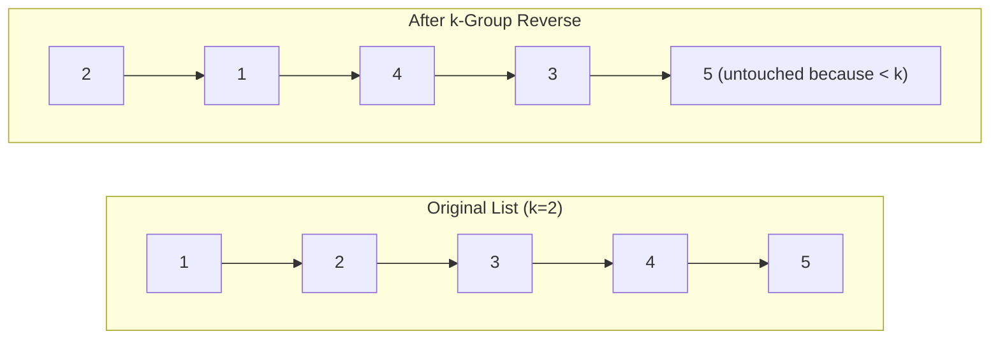
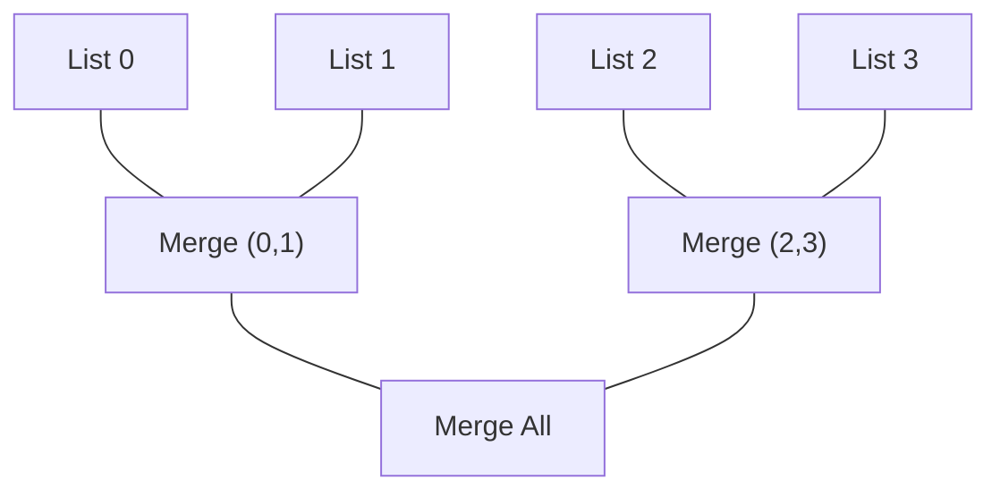
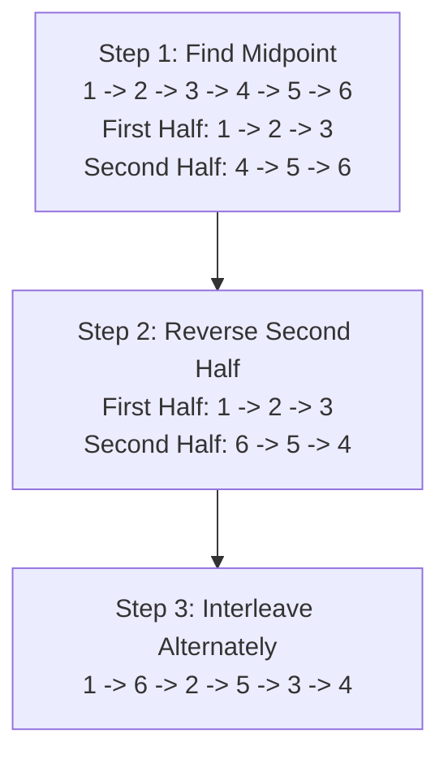
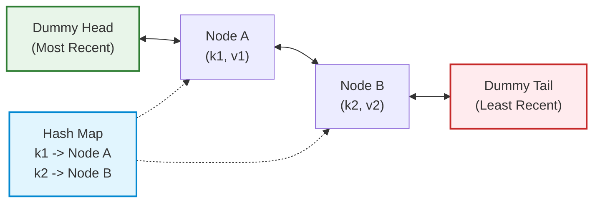

# Linked List: FAANG Coding Interview Mastery Guide 🎯

A battle-tested, visually rigorous interview guide covering the **5 core problem archetypes**, bug traps, pointer surgery diagrams, and production-grade solutions in **Python** and **Java**.

---

## 🧭 Master Problem Index

| # | Problem | Difficulty | Core Pattern | Key Bug Trap / Edge Case | Time | Space |
|---|---------|------------|--------------|--------------------------|------|-------|
| 1 | **Reverse Linked List** (LC 206) | Easy | 3-Pointer Iteration | Losing `curr.next` before reversing | $\mathcal{O}(N)$ | $\mathcal{O}(1)$ |
| 2 | **Reverse Linked List II** (LC 92) | Medium | Subsegment Reversal | Reconnecting sublist boundaries to outer list | $\mathcal{O}(N)$ | $\mathcal{O}(1)$ |
| 3 | **Reverse Nodes in k-Group** (LC 25) | Hard | Modular Group Surgery | Leftover nodes $< k$ must NOT be reversed | $\mathcal{O}(N)$ | $\mathcal{O}(1)$ |
| 4 | **Linked List Cycle II** (LC 142) | Medium | Floyd's Fast & Slow + Math | Off-by-one meeting point calculation | $\mathcal{O}(N)$ | $\mathcal{O}(1)$ |
| 5 | **Remove Nth Node From End** (LC 19) | Medium | Fixed-Distance Window | Removing the head node itself | $\mathcal{O}(N)$ | $\mathcal{O}(1)$ |
| 6 | **Merge Two Sorted Lists** (LC 21) | Easy | Sentinel Node + Two Pointers | Appending remaining non-null tail | $\mathcal{O}(N)$ | $\mathcal{O}(1)$ |
| 7 | **Merge k Sorted Lists** (LC 23) | Hard | Divide & Conquer / Min-Heap | Creating new nodes vs rewiring existing pointers | $\mathcal{O}(N \log k)$ | $\mathcal{O}(1)$ |
| 8 | **Reorder List** (LC 143) | Medium | Find Mid $\to$ Reverse $\to$ Merge | Creating a cycle by not severing mid `next = None` | $\mathcal{O}(N)$ | $\mathcal{O}(1)$ |
| 9 | **Copy List with Random Pointer** (LC 138) | Medium | Interweaving Trick | Decoupling original and clone lists cleanly | $\mathcal{O}(N)$ | $\mathcal{O}(1)$ |
| 10 | **LRU Cache** (LC 146) | Medium/Hard | Hash Map + Doubly Linked List | Node removal / insertion boundary edge cases | $\mathcal{O}(1)$ | $\mathcal{O}(\text{capacity})$ |

---

## 🛡️ The 4 Golden Rules of Linked List Interviews

Before writing a single line of code in any FAANG interview, apply these 4 rules:

```
┌────────────────────────────────────────────────────────────────────────────────────────┐
│                        THE 4 INVIOLABLE LINKED LIST RULES                              │
├────────────────────────────────────────────────────────────────────────────────────────┤
│ 1. ALWAYS USE A DUMMY (SENTINEL) NODE:                                                 │
│    dummy = ListNode(0, head)                                                           │
│    Eliminates 95% of edge cases (empty list, 1-node list, modifying the head).         │
│                                                                                        │
│ 2. SAVE BEFORE YOU SEVER:                                                              │
│    nxt = curr.next   # NEVER write curr.next = ... without saving nxt first!           │
│    The moment you reassign a pointer, you orphan the rest of the list in memory.       │
│                                                                                        │
│ 3. SKETCH THE POINTER TRANSITIONS BEFORE CODING:                                       │
│    Draw the 3 nodes: [prev] -> [curr] -> [nxt]. Write the 4 pointer reassignment lines │
│    on your whiteboard/scratchpad first.                                                │
│                                                                                        │
│ 4. SEVER THE TAIL ON MULTI-STEP PROBLEMS:                                              │
│    When splitting a list into two halves (e.g., Reorder List, Sort List), you MUST     │
│    explicitly set `mid.next = None`. Forgetting this creates an infinite cycle!        │
└────────────────────────────────────────────────────────────────────────────────────────┘
```

---

## 🔁 Pattern 1: In-Place Pointer Reversals

---

### Problem 1: Reverse Linked List (LeetCode 206)
> **Prompt:** Given the `head` of a singly linked list, reverse the list in-place and return the reversed list.

#### 🧠 Intuition & Pointer Dance:
To reverse a list in $\mathcal{O}(1)$ auxiliary space, maintain 3 pointers: `prev`, `curr`, and `nxt`.  
At every step, point `curr.next` backwards to `prev`, then shift both pointers forward.

```
Initial State:
prev(None)     curr(1) ──► (2) ──► (3) ──► None

Step 1: Save nxt = curr.next (2)
Step 2: Point curr.next = prev (None)
Step 3: prev = curr (1)
Step 4: curr = nxt (2)

Result after 1 step:
None ◄── (1)      curr(2) ──► (3) ──► None
          ▲
         prev
```

#### 💻 Python Implementation:
```python
class ListNode:
    def __init__(self, val=0, next=None):
        self.val = val
        self.next = next

def reverseList(head: ListNode) -> ListNode:
    prev = None
    curr = head
    
    while curr:
        nxt = curr.next      # 1. Save forward address
        curr.next = prev     # 2. Reverse pointer
        prev = curr          # 3. Advance prev
        curr = nxt           # 4. Advance curr
        
    return prev              # prev is the new head!
```

#### ☕ Java Implementation:
```java
public class Solution {
    public ListNode reverseList(ListNode head) {
        ListNode prev = null;
        ListNode curr = head;
        
        while (curr != null) {
            ListNode nxt = curr.next;
            curr.next = prev;
            prev = curr;
            curr = nxt;
        }
        return prev;
    }
}
```

* **Time Complexity:** $\mathcal{O}(N)$ — Single pass through all $N$ nodes.
* **Space Complexity:** $\mathcal{O}(1)$ — Only three pointer references.

---

### Problem 2: Reverse Linked List II (LeetCode 92)
> **Prompt:** Reverse nodes from position `left` to `right` in a single pass. ($1 \le \text{left} \le \text{right} \le N$).

#### 🧠 The "Head Insertion" Pointer Technique:
Instead of severing and reconnecting separate lists, use the **Head-Insertion Trick**:
1. Walk a `pre` pointer to node `left - 1`.
2. Keep a `start` pointer at node `left`.
3. In each iteration, pluck the node `then = start.next` and move it directly after `pre`.

```
Example: 1 -> 2 -> 3 -> 4 -> 5, left = 2, right = 4
pre = 1, start = 2, then = 3

Iteration 1 (move 3 after 1):
1 -> 3 -> 2 -> 4 -> 5
pre = 1, start = 2, then = 4

Iteration 2 (move 4 after 1):
1 -> 4 -> 3 -> 2 -> 5 (DONE!)
```

#### 💻 Python Implementation:
```python
def reverseBetween(head: ListNode, left: int, right: int) -> ListNode:
    dummy = ListNode(0, head)
    pre = dummy
    
    # 1. Reach the node just before 'left'
    for _ in range(left - 1):
        pre = pre.next
        
    start = pre.next   # The first node of the sublist to reverse
    then = start.next  # The node to be moved to the front
    
    # 2. Perform (right - left) insertions
    for _ in range(right - left):
        start.next = then.next
        then.next = pre.next
        pre.next = then
        then = start.next
        
    return dummy.next
```

* **Time Complexity:** $\mathcal{O}(N)$ — At most $N$ operations.
* **Space Complexity:** $\mathcal{O}(1)$ — In-place pointer swapping.

---

### Problem 3: Reverse Nodes in k-Group (LeetCode 25 - Hard)
> **Prompt:** Reverse the nodes of a linked list `k` at a time and return its modified list. Nodes remaining at the end (less than `k`) must remain in their original order.

#### 🧠 The 4-Step Strategy:
1. **Count Ahead:** Check if there are at least $k$ nodes remaining. If not, stop.
2. **Reverse $k$ nodes:** Standard reverse of subsegment.
3. **Reconnect Boundaries:** Connect the previous group's tail to the newly reversed group's head, and the new tail to the next group.
4. **Advance:** Update group previous pointer and repeat.



#### 💻 Python Implementation:
```python
def reverseKGroup(head: ListNode, k: int) -> ListNode:
    dummy = ListNode(0, head)
    group_prev = dummy
    
    def get_kth(curr, steps):
        while curr and steps > 0:
            curr = curr.next
            steps -= 1
        return curr

    while True:
        kth = get_kth(group_prev, k)
        if not kth:
            break  # Less than k nodes left, leave as is!
            
        group_next = kth.next
        
        # Reverse group: from group_prev.next to kth
        prev, curr = group_next, group_prev.next
        while curr != group_next:
            nxt = curr.next
            curr.next = prev
            prev = curr
            curr = nxt
            
        # Re-link group_prev to new head of group (kth)
        temp = group_prev.next
        group_prev.next = kth
        group_prev = temp
        
    return dummy.next
```

---

## 🏃 Pattern 2: Fast & Slow Pointer (Floyd's Tortoise & Hare)

---

### Problem 4: Linked List Cycle II (Find Entry Node) (LeetCode 142)
> **Prompt:** Given a linked list, return the exact node where the cycle begins. If there is no cycle, return `null`. Do NOT modify the list. Space must be $\mathcal{O}(1)$.

#### 📐 The Mathematical Proof Behind Floyd's Cycle Detection:

```
Head                                Entry
  o ────────── L1 ───────────────────► o
                                     /   \
                                    /     \
                                   |   C   |  <- Cycle of length C
                                    \     /
                                     \   /
                                       o Meeting Point (d distance from Entry)
```

1. Let $L_1$ be the distance from `Head` to `Entry`.
2. Let $C$ be the circumference of the cycle.
3. Let $d$ be the distance from `Entry` to the `Meeting Point`.
4. At the meeting point:
   $$\text{Distance}(\text{Slow}) = L_1 + d$$
   $$\text{Distance}(\text{Fast}) = L_1 + nC + d \quad (n \ge 1)$$
5. Since Fast travels at **twice the speed** of Slow:
   $$2 \times \text{Distance}(\text{Slow}) = \text{Distance}(\text{Fast})$$
   $$2(L_1 + d) = L_1 + nC + d$$
   $$2L_1 + 2d = L_1 + nC + d$$
   $$L_1 + d = nC$$
   $$\mathbf{L_1 = nC - d}$$

> **The Grand FAANG Epiphany:**  
> The distance from `Head` to `Entry` ($L_1$) is **exactly equal** to the distance from `Meeting Point` to `Entry` ($nC - d$)!  
> Therefore, if you place one pointer at `Head` and keep another at `Meeting Point`, and advance both at **1 step per second**, they are mathematically guaranteed to collide at the **Cycle Entry Node**!

#### 💻 Python Implementation:
```python
def detectCycle(head: ListNode) -> ListNode:
    slow = fast = head
    
    # Phase 1: Determine if a cycle exists
    while fast and fast.next:
        slow = slow.next
        fast = fast.next.next
        if slow == fast:
            break
    else:
        return None  # fast reached None -> No cycle!
        
    # Phase 2: Find entry node (advance head & slow at same speed)
    entry = head
    while entry != slow:
        entry = entry.next
        slow = slow.next
        
    return entry
```

---

### Problem 5: Remove Nth Node From End of List (LeetCode 19)
> **Prompt:** Given the head of a linked list, remove the $n$-th node from the end of the list and return its head in **one single pass**.

#### 🧠 Fixed-Distance Window Technique:
1. Create a `dummy` node pointing to `head`.
2. Place `fast` at `dummy`, advance `fast` by $n + 1$ steps.
3. Place `slow` at `dummy`.
4. Now `fast` and `slow` maintain a fixed gap of $n + 1$ nodes!
5. Move both `fast` and `slow` forward until `fast` hits `None`.
6. `slow` is now resting **immediately before** the node to delete!
7. Remove node: `slow.next = slow.next.next`.

```
Example: [1, 2, 3, 4, 5], n = 2 (Delete 4)
dummy -> 1 -> 2 -> 3 -> 4 -> 5 -> None
  ▲                ▲
 slow             fast (advanced by n + 1 = 3 steps)

Move until fast reaches None:
dummy -> 1 -> 2 -> 3 -> 4 -> 5 -> None
                   ▲                ▲
                  slow             fast

Delete: slow.next = slow.next.next (3 points to 5)
```

#### 💻 Python Implementation:
```python
def removeNthFromEnd(head: ListNode, n: int) -> ListNode:
    dummy = ListNode(0, head)
    fast = slow = dummy
    
    # 1. Advance fast by n + 1 steps
    for _ in range(n + 1):
        fast = fast.next
        
    # 2. Advance both until fast reaches the end
    while fast:
        slow = slow.next
        fast = fast.next
        
    # 3. Sever the nth node
    slow.next = slow.next.next
    
    return dummy.next
```

---

## 🔀 Pattern 3: Sentinel Node Stitching & Merging

---

### Problem 6: Merge Two Sorted Lists (LeetCode 21)
> **Prompt:** Merge two sorted singly linked lists into one sorted list by splicing nodes together.

#### 💻 Python Implementation:
```python
def mergeTwoLists(l1: ListNode, l2: ListNode) -> ListNode:
    dummy = ListNode(0)
    curr = dummy
    
    while l1 and l2:
        if l1.val <= l2.val:
            curr.next = l1
            l1 = l1.next
        else:
            curr.next = l2
            l2 = l2.next
        curr = curr.next
        
    # Splice whichever list still has nodes left
    curr.next = l1 if l1 else l2
    
    return dummy.next
```

---

### Problem 7: Merge k Sorted Lists (LeetCode 23 - Hard)
> **Prompt:** You are given an array of $k$ linked lists, each sorted in ascending order. Merge all the linked lists into one sorted linked list and return it.

#### ⚔️ The Architectural Comparison:

| Approach | Time Complexity | Space Complexity | Interview Feedback |
| :--- | :--- | :--- | :--- |
| **Approach 1: One-by-One Merge** | $\mathcal{O}(k^2 \cdot N)$ | $\mathcal{O}(1)$ | ❌ Rejected (Too slow, quadratic in $k$) |
| **Approach 2: Min-Heap / Priority Queue** | $\mathcal{O}(N \log k)$ | $\mathcal{O}(k)$ (Heap size) | ✅ Accepted (Standard solution) |
| **Approach 3: Divide & Conquer (Bottom-Up)** | $\mathbf{\mathcal{O}(N \log k)}$ | $\mathbf{\mathcal{O}(1)}$ | 🌟 **Rockstar Rating (Optimal, zero heap overhead!)** |

#### 🧠 Divide & Conquer (Pairwise Merge):
Pair up the $k$ lists and merge each pair using `mergeTwoLists`. After the first pass, $k$ lists become $k/2$. Repeat until only 1 list remains!



#### 💻 Python Implementation (Divide & Conquer):
```python
def mergeKLists(lists: list[ListNode]) -> ListNode:
    if not lists:
        return None
        
    def merge_two(l1: ListNode, l2: ListNode) -> ListNode:
        dummy = ListNode(0)
        curr = dummy
        while l1 and l2:
            if l1.val <= l2.val:
                curr.next, l1 = l1, l1.next
            else:
                curr.next, l2 = l2, l2.next
            curr = curr.next
        curr.next = l1 or l2
        return dummy.next

    interval = 1
    amount = len(lists)
    while interval < amount:
        for i in range(0, amount - interval, interval * 2):
            lists[i] = merge_two(lists[i], lists[i + interval])
        interval *= 2
        
    return lists[0]
```

* **Time Complexity:** $\mathcal{O}(N \log k)$ where $N$ is total nodes across all lists and $k$ is number of lists.
* **Space Complexity:** $\mathcal{O}(1)$ auxiliary space.

---

## ✂️ Pattern 4: Multi-Stage Surgical Transformations

---

### Problem 8: Reorder List (LeetCode 143)
> **Prompt:** Reorder $L_0 \to L_1 \to \dots \to L_{n-1} \to L_n$ into $L_0 \to L_n \to L_1 \to L_{n-1} \to L_2 \to L_{n-2} \dots$ in-place without altering node values.

#### 🧠 The 3-Phase Surgery:
1. **Find Middle:** Use fast & slow pointers.
2. **Reverse Second Half:** Disconnect middle (`mid.next = None`) and reverse the remaining list.
3. **Interleave (Zipper Merge):** Alternately stitch nodes from First Half and Reversed Second Half.



#### 💻 Python Implementation:
```python
def reorderList(head: ListNode) -> None:
    if not head or not head.next:
        return

    # Phase 1: Find middle using fast & slow pointers
    slow, fast = head, head
    while fast and fast.next:
        slow = slow.next
        fast = fast.next.next

    # Phase 2: Reverse the second half
    prev = None
    curr = slow.next
    slow.next = None  # CRITICAL: Sever the first half to avoid infinite cycles!
    
    while curr:
        nxt = curr.next
        curr.next = prev
        prev = curr
        curr = nxt
    second = prev  # Head of reversed second half
    
    # Phase 3: Interleave first and second halves
    first = head
    while second:
        tmp1, tmp2 = first.next, second.next
        first.next = second
        second.next = tmp1
        first, second = tmp1, tmp2
```

---

### Problem 9: Copy List with Random Pointer (LeetCode 138)
> **Prompt:** A linked list has an additional `random` pointer that could point to any node in the list, or `null`. Construct a deep copy of the list.

#### 🧠 The $\mathcal{O}(1)$ Space Interleaving Trick:
Instead of using a Hash Map ($\mathcal{O}(N)$ memory), we clone nodes **directly next to the original nodes**:

```
Step 1: Interleave cloned nodes:
Original: 1 ──────────► 2 ──────────► 3
Cloned:   1 ──► 1' ───► 2 ──► 2' ───► 3 ──► 3'

Step 2: Assign random pointers:
If curr.random exists:
curr.next.random = curr.random.next (1'.random = 1.random')

Step 3: Decouple the lists back into Original and Clone!
```

#### 💻 Python Implementation:
```python
class Node:
    def __init__(self, x: int, next: 'Node' = None, random: 'Node' = None):
        self.val = int(x)
        self.next = next
        self.random = random

def copyRandomList(head: 'Node') -> 'Node':
    if not head:
        return None
        
    # Phase 1: Interleave cloned nodes
    curr = head
    while curr:
        clone = Node(curr.val, curr.next)
        curr.next = clone
        curr = clone.next
        
    # Phase 2: Assign random pointers to cloned nodes
    curr = head
    while curr:
        if curr.random:
            curr.next.random = curr.random.next
        curr = curr.next.next
        
    # Phase 3: Separate original and cloned lists
    curr = head
    clone_head = head.next
    while curr:
        clone = curr.next
        curr.next = clone.next
        if clone.next:
            clone.next = clone.next.next
        curr = curr.next
        
    return clone_head
```

* **Time Complexity:** $\mathcal{O}(N)$ — Three linear passes.
* **Space Complexity:** $\mathcal{O}(1)$ auxiliary space (excluding the returned cloned list).

---

## 🏛️ Pattern 5: Doubly Linked List Systems Design

---

### Problem 10: LRU Cache (LeetCode 146 - FAANG Classic)
> **Prompt:** Design a data structure that follows the constraints of a **Least Recently Used (LRU) cache**. Implement `get(key)` and `put(key, value)` both running in **strict $\mathcal{O}(1)$ average time complexity**.

#### 🧠 Architectural Harmony:
* **Hash Map:** Gives $\mathcal{O}(1)$ key lookup. Stores `key -> Node`.
* **Doubly Linked List:** Gives $\mathcal{O}(1)$ node removal and $\mathcal{O}(1)$ insertion at head.
* **Sentinel Nodes:** `head` and `tail` dummy nodes eliminate all `null` pointer boundary checks.



#### 💻 Python Implementation:
```python
class DListNode:
    def __init__(self, key: int = 0, val: int = 0):
        self.key = key
        self.val = val
        self.prev = None
        self.next = None

class LRUCache:
    def __init__(self, capacity: int):
        self.capacity = capacity
        self.cache = {}  # key -> DListNode
        
        # Sentinel dummy nodes
        self.head = DListNode()
        self.tail = DListNode()
        self.head.next = self.tail
        self.tail.prev = self.head

    def _remove(self, node: DListNode):
        """O(1) in-place node extraction."""
        node.prev.next = node.next
        node.next.prev = node.prev

    def _add_to_front(self, node: DListNode):
        """O(1) insertion right after dummy head."""
        node.next = self.head.next
        node.prev = self.head
        self.head.next.prev = node
        self.head.next = node

    def get(self, key: int) -> int:
        if key not in self.cache:
            return -1
        node = self.cache[key]
        self._remove(node)
        self._add_to_front(node)  # Mark as most recently used
        return node.val

    def put(self, key: int, value: int) -> None:
        if key in self.cache:
            node = self.cache[key]
            node.val = value
            self._remove(node)
            self._add_to_front(node)
        else:
            if len(self.cache) >= self.capacity:
                # Evict least recently used (node right before dummy tail)
                lru = self.tail.prev
                self._remove(lru)
                del self.cache[lru.key]
                
            new_node = DListNode(key, value)
            self.cache[key] = new_node
            self._add_to_front(new_node)
```

---

## 🎓 Summary: Interview Cheat Sheet

```
+-----------------------------------------------------------------------------------------------+
| PROBLEM TYPE             | BEST TECHNIQUE            | TIME    | SPACE | KEY TAKEAWAY        |
+--------------------------+---------------------------+---------+-------+---------------------+
| Reversal (Full/Partial)  | 3-pointer (prev,curr,nxt) | O(N)    | O(1)  | Cache next first!   |
| Cycle Detection / Middle | Fast & Slow (Floyd's)     | O(N)    | O(1)  | 2x speed difference |
| K-th from End            | 2-pointer fixed window    | O(N)    | O(1)  | Advance fast k+1    |
| List Merging             | Sentinel Dummy Node       | O(N)    | O(1)  | Splice leftovers    |
| Merge K Lists            | Bottom-up Divide&Conquer  | O(NlogK)| O(1)  | Avoid heap overhead |
| Palindrome / Reorder     | Mid -> Reverse -> Merge   | O(N)    | O(1)  | Sever mid.next!     |
| Random Pointer Clone     | Interleaving A -> A'      | O(N)    | O(1)  | No hash map needed  |
| LRU Cache                | HashMap + DoublyLinkedList| O(1)    | O(C)  | Sentinel boundaries |
+-----------------------------------------------------------------------------------------------+
```
