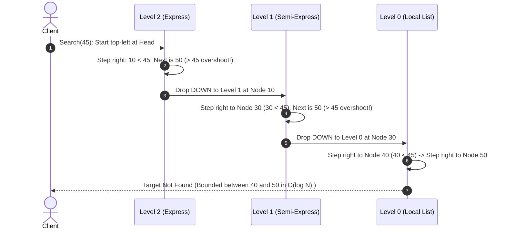
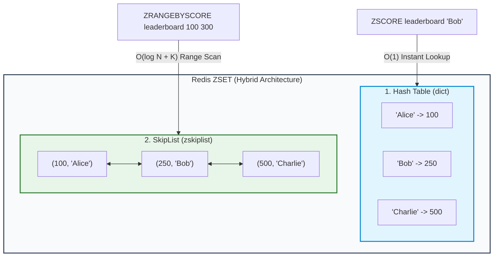

# SkipLists & Redis Sorted Sets (ZSET): The FAANG Interview Masterclass ⚡🎿

A comprehensive, visual, and mathematical deep dive into **SkipLists** — how multi-level probabilistic pointers achieve $\mathcal{O}(\log N)$ search, and **the legendary interview question: why Redis chose SkipLists over Red-Black Trees for Sorted Sets.**

---

## 🧭 Document Navigation

```
SkipList_and_ZSet_Guide/
├── 1. 🚆 The Core Mental Model: The Express Train Analogy
├── 2. 🧱 SkipList Architecture: Multi-Level Probabilistic Pointers
├── 3. 🔍 How Search, Insert & Delete Work (Step-by-Step Traversal)
├── 4. 🎲 The Coin Toss: Probabilistic Height Generation
├── 5. 📊 Big-O Complexity Comparison: SkipList vs. Red-Black Tree vs. Array
├── 6. 🔥 The Billion-Dollar Question: Why Redis Chose SkipList Over Red-Black Tree
│   ├── Factor 1: Range Queries (ZRANGEBYSCORE) & Cache Locality
│   ├── Factor 2: Concurrency & Lock-Free Simplicity
│   ├── Factor 3: Memory Tuning (The p = 0.25 Redis Secret)
│   └── Factor 4: Implementation Simplicity & Code Maintenance
├── 7. 👑 Redis ZSET Under the Hood: The SkipList + HashMap Hybrid
└── 8. 🐍 Clean Python Implementation of a SkipList
```

---

## 🚆 1. The Core Mental Model: The Express Train Analogy

To understand why a SkipList exists, look at a standard Singly Linked List:

```
[ Head ] ──► [ 10 ] ──► [ 20 ] ──► [ 30 ] ──► [ 40 ] ──► [ 50 ] ──► [ 60 ] ──► [ 70 ] ──► [ 80 ]
```

* Searching for `80` requires visiting every single node: $\mathcal{O}(N)$ sequential time.
* It is like a **Local Train** that stops at every single station. Even if the data is sorted, you cannot perform Binary Search on a Linked List because you cannot jump to the middle node in $O(1)$!

### The Breakthrough: Add Express Tracks! 🚄
What if we build a subway system with multiple express tracks above the local track?

* **Level 2 (Bullet Train):** Stops only at stations `10` and `50`.
* **Level 1 (Express Train):** Stops at `10`, `30`, `50`, `70`.
* **Level 0 (Local Train):** Stops at every station: `10, 20, 30, 40, 50, 60, 70, 80`.

```
Level 2 (Express): [ 10 ] ─────────────────────────► [ 50 ] ─────────────────────────► [ NIL ]
                      │                                 │
Level 1 (Semi-Exp):[ 10 ] ──────────► [ 30 ] ───────► [ 50 ] ──────────► [ 70 ] ──────► [ NIL ]
                      │                  │              │                  │
Level 0 (Local):   [ 10 ] ──► [ 20 ] ──► [ 30 ] ──► [ 40 ] ──► [ 50 ] ──► [ 60 ] ──► [ 70 ] ──► [ 80 ]
```

#### Searching for 70:
1. Start at **Level 2** at `10`. Look ahead $\to$ `50`. Since $50 < 70$, jump to `50`. Next is `NIL`. Drop DOWN to **Level 1**.
2. At **Level 1**, look ahead from `50` $\to$ `70`. Target found!
3. **Total steps:** Only **3 comparisons** instead of 7!

---

## 🧱 2. SkipList Architecture: Multi-Level Pointers

Invented by William Pugh in 1989, a **SkipList** is a probabilistic data structure that organizes elements in sorted order across multiple linked layers:

* **Base Layer ($L_0$):** Contains **100% of all elements** in strictly sorted order.
* **Layer 1 ($L_1$):** Contains roughly $\approx 50\%$ of elements.
* **Layer 2 ($L_2$):** Contains roughly $\approx 25\%$ of elements.
* **Layer $k$ ($L_k$):** Contains roughly $\approx \frac{1}{2^k}$ of elements.

Each node contains a value/score and an **array of forward pointers** (`forward[level]`), where `node.forward[0]` points to the immediate neighbor on Level 0, and `node.forward[i]` points to the neighbor on Level $i$.

---

## 🔍 3. How Search, Insert & Delete Work



### The Universal Traversal Rule:
$$\text{Move RIGHT as far as possible while } \text{next.value} < \text{target.}$$
$$\text{When } \text{next.value} \ge \text{target, drop DOWN one level.}$$

---

## 🎲 4. The Coin Toss: Probabilistic Height Generation

In a Red-Black Tree or AVL tree, maintaining balance requires complex rotations and color rules.  
**In a SkipList, balance is maintained purely by flipping a coin!**

When inserting a new element:
1. Always add it to **Level 0**.
2. Flip a coin (probability $p = 0.5$):
   * **Heads:** Promote the node to Level 1. Flip again!
   * **Heads:** Promote to Level 2. Flip again!
   * **Tails:** Stop!
3. The node's height is determined **once upon insertion** and never changes.

```python
import random

def random_level(max_level=32, p=0.25) -> int:
    level = 1
    # Keep promoting with probability p
    while random.random() < p and level < max_level:
        level += 1
    return level
```

Because each level has approximately half (or a quarter) the nodes of the level below it, the maximum expected height is:
$$\text{Expected Height} = \log_{1/p}(N) \implies \mathcal{O}(\log N)$$

---

## 📊 5. Big-O Complexity Comparison

| Operation | Sorted Array | Singly Linked List | Red-Black Tree | SkipList 🎿 |
| :--- | :--- | :--- | :--- | :--- |
| **Search / Lookup** | ⚡ $\mathcal{O}(\log N)$ | 🐢 $\mathcal{O}(N)$ | ⚡ $\mathcal{O}(\log N)$ | ⚡ $\mathcal{O}(\log N)$ (Avg) |
| **Insert** | 🐢 $\mathcal{O}(N)$ (shifts data) | ⚡ $\mathcal{O}(1)$ (with ptr) | ⚡ $\mathcal{O}(\log N)$ | ⚡ $\mathcal{O}(\log N)$ (Avg) |
| **Delete** | 🐢 $\mathcal{O}(N)$ (shifts data) | ⚡ $\mathcal{O}(1)$ (with ptr) | ⚡ $\mathcal{O}(\log N)$ | ⚡ $\mathcal{O}(\log N)$ (Avg) |
| **Range Query ($K$ items)**| ⚡ $\mathcal{O}(\log N + K)$ | 🐢 $\mathcal{O}(N)$ | 🟡 $\mathcal{O}(\log N + K)$ | ⚡ $\mathcal{O}(\log N + K)$ |
| **Implementation Complexity**| Low | Low | 🔴 **High (Dozens of rotation cases)** | 🟢 **Simple (Standard pointers)** |
| **Concurrent Lock-Free** | Hard | N/A | 🔴 **Extremely Hard** | 🟢 **Easy (Local pointer CAS)** |

---

## 🔥 6. The Billion-Dollar Question: Why Redis Chose SkipList Over Red-Black Tree

Salvatore Sanfilippo (Antirez), the creator of Redis, was explicitly asked why he picked a **SkipList** instead of a standard **Red-Black Tree** for Redis Sorted Sets (`ZSET`).

His answer contains **4 master engineering principles** tested in FAANG senior system design interviews:

---

### Factor 1: Range Queries (`ZRANGEBYSCORE`) are Blazing Fast 🎯

Redis Sorted Sets are heavily used for range lookups:
* *"Give me all players with scores between 1,000 and 5,000."* (`ZRANGEBYSCORE leaderboard 1000 5000`)
* *"Get the top 10 players."* (`ZREVRANGE leaderboard 0 9`)

```
SkipList Level 0 Range Traversal:
  [ Match Start: 1000 ] ──► [ 1050 ] ──► [ 1120 ] ──► ... ──► [ 5000 ]
```

* **In a SkipList:** You search for `1000` in $\mathcal{O}(\log N)$ time to land on Level 0. Once you are there, **you simply traverse forward along the contiguous Level 0 pointers like a regular linked list!** It has incredible CPU cache locality and zero stack overhead.
* **In a Red-Black Tree:** Finding `1000` takes $\mathcal{O}(\log N)$. But iterating through subsequent in-order elements requires **jumping back up to parents, traversing down right subtrees, and maintaining a call stack or parent pointer links**, causing random memory hopping and destroying CPU L1 cache prefetching!

---

### Factor 2: Concurrency & Lock-Free Threading 🔒

* When you insert or delete a node in a **Red-Black Tree**, rebalancing rotations can cascade all the way up to the root node. In multi-threaded systems, this forces you to **lock large sections of the entire tree**.
* In a **SkipList**, insertions and deletions are **strictly local operations**. You only update the forward pointers of the immediate neighbors at each level. It is trivial to make lock-free or fine-grained concurrent SkipLists using atomic Compare-And-Swap (`CAS`).

---

### Factor 3: Memory Tuning (The $p = 0.25$ Redis Secret) 💾

Textbooks analyze SkipLists with probability $p = 0.5$ (each node has a $50\%$ chance of promotion).  
**Redis tunes this to $p = 0.25$!**

#### The Math:
The expected number of forward pointers per node is:
$$\text{Expected Pointers} = \sum_{k=0}^{\infty} p^k = \frac{1}{1 - p}$$

* With $p = 0.5$: $\frac{1}{1 - 0.5} = \mathbf{2.0\text{ pointers per node}}$.
* With Redis's $p = 0.25$: $\frac{1}{1 - 0.25} = \mathbf{1.33\text{ pointers per node}}$!

A Red-Black Tree node **strictly requires 3 pointers** (`left`, `right`, `parent`) plus a color bit ($3 \times 8\text{ bytes} + 1\text{ byte} = \mathbf{25\text{ bytes of overhead}}$ per entry).  
Redis's SkipList with $p = 0.25$ uses **less memory per node on average than a balanced tree** while keeping the tree height shallow!

---

### Factor 4: Implementation Simplicity & Debuggability 🛠️

A production Red-Black Tree requires hundreds of lines of complex pointer re-linking, left/right rotations, color flips, and edge-case handling for node deletion (black-height restoration).  
A SkipList requires $\approx 50$ lines of clean C code that is vastly easier to audit, optimize, and maintain without subtle rebalancing memory bugs.

---

## 👑 7. Redis ZSET Under the Hood: The SkipList + HashMap Hybrid

A Redis Sorted Set does not rely solely on a SkipList. It is a **dual-engine hybrid**:



* **The Hash Table (`dict`):** Maps `Member Name -> Score`.  
  Enables `ZSCORE leaderboard "Bob"` to return Bob's score in **instant $\mathcal{O}(1)$ time**.
* **The SkipList (`zskiplist`):** Stores pairs ordered by `(Score, Member)`.  
  Enables `ZRANK`, `ZREVRANGE`, and `ZRANGEBYSCORE` to execute in **$\mathcal{O}(\log N + K)$ time**.

Both structures point to the exact same shared string objects in RAM, keeping memory overhead minimal!

---

## 🐍 8. Clean Python Implementation of a SkipList

```python
import random

class SkipNode:
    def __init__(self, val: int, level: int):
        self.val = val
        # Array of forward pointers for each level (0 to level-1)
        self.forward = [None] * level

class SkipList:
    def __init__(self, max_level: int = 16, p: float = 0.5):
        self.max_level = max_level
        self.p = p
        self.level = 1
        # Sentinel head node with max possible level
        self.head = SkipNode(-float('inf'), max_level)

    def _random_level(self) -> int:
        lvl = 1
        while random.random() < self.p and lvl < self.max_level:
            lvl += 1
        return lvl

    def search(self, target: int) -> bool:
        curr = self.head
        # Traverse from the top level down to level 0
        for i in range(self.level - 1, -1, -1):
            while curr.forward[i] and curr.forward[i].val < target:
                curr = curr.forward[i]  # Move RIGHT
            # Drop DOWN to i-1 automatically in next loop iteration
        
        curr = curr.forward[0]
        return curr is not None and curr.val == target

    def insert(self, val: int):
        update = [None] * self.max_level
        curr = self.head

        # 1. Track the predecessor nodes at each level where we drop down
        for i in range(self.level - 1, -1, -1):
            while curr.forward[i] and curr.forward[i].val < val:
                curr = curr.forward[i]
            update[i] = curr

        # 2. Generate random height for new node
        new_level = self._random_level()
        if new_level > self.level:
            for i in range(self.level, new_level):
                update[i] = self.head
            self.level = new_level

        # 3. Splice new node into forward pointers at each level
        new_node = SkipNode(val, new_level)
        for i in range(new_level):
            new_node.forward[i] = update[i].forward[i]
            update[i].forward[i] = new_node

    def delete(self, val: int) -> bool:
        update = [None] * self.max_level
        curr = self.head

        for i in range(self.level - 1, -1, -1):
            while curr.forward[i] and curr.forward[i].val < val:
                curr = curr.forward[i]
            update[i] = curr

        target_node = curr.forward[0]
        if not target_node or target_node.val != val:
            return False  # Node not found

        # Update pointers to bypass target_node
        for i in range(self.level):
            if update[i].forward[i] != target_node:
                break
            update[i].forward[i] = target_node.forward[i]

        # Lower current max level if top levels are now empty
        while self.level > 1 and self.head.forward[self.level - 1] is None:
            self.level -= 1

        return True
```
