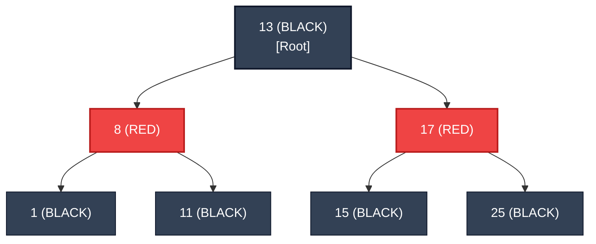

# Red-Black Trees: Complete FAANG Interview & Internal Architecture Guide 🌲🔴⚫

A mathematically rigorous, visual, and intuitive guide to **Self-Balancing Binary Search Trees (Red-Black Trees)** — understanding tree balance, rotations, the 5 core invariants, real-world language runtimes, and why they matter in systems engineering.

---

## 🧭 Document Navigation

```
RedBlackTree_Guide/
├── 1. 🧠 Why We Need Self-Balancing Trees (The Degenerate BST Disaster)
├── 2. ⚖️ AVL Trees vs. Red-Black Trees (The Balancing Trade-Off)
├── 3. 📜 The 5 Inviolable Rules of Red-Black Trees
│   ├── Rule 1 to 5 Explained Intuitively
│   └── The Black-Height Mathematical Guarantee (Max Height <= 2*log(N+1))
├── 4. 🔄 Tree Rotations Demystified (Left & Right Rotations)
├── 5. 🛠️ Insertion Rebalancing Cases (Recoloring vs. Rotations)
│   ├── Case 1: Uncle is RED (Simple Recoloring)
│   ├── Case 2: Uncle is BLACK (Triangle -> Double Rotation)
│   └── Case 3: Uncle is BLACK (Line -> Single Rotation)
├── 6. 📊 Big-O Complexity Matrix (Worst-Case Guarantees)
└── 7. 🌐 Where Red-Black Trees Power Real-World Software
    ├── C++ STL (`std::map`, `std::set`)
    ├── Java Standard Library (`TreeMap`, `TreeSet`, HashMap Treeification)
    ├── The Linux Kernel (Completely Fair Scheduler - CFS)
    └── The Teaser: Why Redis Chose SkipLists Instead!
```

---

## 🧠 1. Why We Need Self-Balancing Trees (The Degenerate BST Disaster)

A basic **Binary Search Tree (BST)** enforces one simple rule:
$$\text{Left Child} < \text{Parent} \le \text{Right Child}$$

When keys are inserted in random order, a BST performs operations in $\mathcal{O}(\log N)$ time.  
**However, what happens when keys arrive already sorted (e.g., `1, 2, 3, 4, 5`)?**

```
Basic BST with sorted inserts:
     1
      \
       2
        \
         3
          \
           4
            \
             5  <-- The Tree degenerated into a Singly Linked List!
```

> **The Catastrophe:**  
> The height of the tree degrades from $h = \log_2 N$ to **$h = N$**.  
> Searching for `5` now takes **$\mathcal{O}(N)$ sequential time instead of $\mathcal{O}(\log N)$**.

To guarantee sub-millisecond lookups under adversarial traffic, computer scientists invented **Self-Balancing Binary Search Trees**.

---

## ⚖️ 2. AVL Trees vs. Red-Black Trees (The Balancing Trade-Off)

In computer science, two self-balancing trees dominate:

| Feature | AVL Tree 🌲 | Red-Black Tree 🔴⚫ |
| :--- | :--- | :--- |
| **Balance Strictness** | **Strictly Balanced:** Height difference between left and right subtrees $\le 1$ ($|h_L - h_R| \le 1$). | **Roughly Balanced:** Longest path from root to leaf is at most **$2\times$ the shortest path**. |
| **Max Tree Height** | $\approx 1.44 \log_2 N$ | $\le 2 \log_2(N + 1)$ |
| **Lookup Speed** | ⚡ **Slightly faster** (shorter tree height). | Fast ($\mathcal{O}(\log N)$). |
| **Insert / Delete Cost** | 🐢 **Slow** (requires frequent expensive rotations to maintain strict $\le 1$ balance). | ⚡ **Faster updates** (fewer rotations; frequently resolved with simple color flips). |
| **Best Used For** | Read-heavy, static databases. | **General-purpose language standard libraries** (C++ `map`, Java `TreeMap`) with frequent inserts/deletes. |

---

## 📜 3. The 5 Inviolable Rules of Red-Black Trees

Every Red-Black Tree is a standard BST where each node carries an extra bit: **RED or BLACK**. A tree is a valid Red-Black Tree if and only if it satisfies these **5 invariant rules**:

```
+---------------------------------------------------------------------------------------+
|                       THE 5 INVIOLABLE RULES OF RED-BLACK TREES                       |
+---------------------------------------------------------------------------------------+
|  1. Every node is either RED or BLACK.                                                |
|  2. The ROOT is always BLACK.                                                         |
|  3. Every NULL leaf node (NIL) is considered BLACK.                                   |
|  4. If a node is RED, both its children MUST be BLACK (No two adjacent RED nodes!).   |
|  5. For any given node, EVERY path from that node down to any of its descendant NIL   |
|     leaves contains the EXACT SAME NUMBER of BLACK NODES (The "Black-Height").         |
+---------------------------------------------------------------------------------------+
```



### 🧮 Why These Rules Guarantee $\mathcal{O}(\log N)$ Height:
* By **Rule 5**, all paths have the same number of Black nodes (let's call it $B$).
* By **Rule 4**, you can never have two Red nodes in a row. Therefore, the shortest possible path is all Black nodes ($B$), and the longest possible path alternates Red and Black ($\text{Black} \to \text{Red} \to \text{Black} \to \text{Red}$), having length at most $2B$.
* **Mathematical Conclusion:**  
  $$\text{Maximum Height} \le 2 \log_2(N + 1)$$
  The tree can never degenerate into a linked list! Lookups, inserts, and deletes are mathematically guaranteed to execute in $\mathcal{O}(\log N)$ worst-case.

---

## 🔄 4. Tree Rotations Demystified (Left & Right Rotations)

When an insertion or deletion violates the 5 rules, the tree restores balance using **Rotations** (pointer updates that change local subtree height in $O(1)$ while preserving BST ordering).

### Left Rotation around Node $X$:
Node $Y$ (the right child) moves UP to become the parent. Node $X$ moves DOWN to become the left child.
```
        X                              Y
       / \      Left Rotation         / \
      A   Y     ─────────────►       X   C
         / \                        / \
        B   C                      A   B
```

### Right Rotation around Node $Y$:
Node $X$ (the left child) moves UP to become the parent. Node $Y$ moves DOWN to become the right child.
```
        Y                              X
       / \      Right Rotation        / \
      X   C     ──────────────►      A   Y
     / \                                / \
    A   B                              B   C
```

> **Notice:** The BST in-order traversal remains $A < X < B < Y < C$ in both diagrams! Rotations change physical tree height without altering sorting order.

---

## 🛠️ 5. Insertion Rebalancing Cases (Recoloring vs. Rotations)

When inserting a new node:
1. Always insert it as a **RED node** at the leaf position (to avoid violating Rule 5's black-height).
2. If its parent is **BLACK**, we are done! No rules violated.
3. If its parent is **RED**, we violate Rule 4 (two adjacent RED nodes!). We inspect the **Uncle** (parent's sibling):

```
+-----------------------------------------------------------------------------------+
|                        THE 3 INSERTION REBALANCING CASES                          |
+-----------------------------------------------------------------------------------+
| CASE 1: UNCLE IS RED                                                              |
| • Fix: Simple Recoloring! Flip Parent and Uncle to BLACK; flip Grandparent to RED.|
| • Zero rotations needed! Move check up to Grandparent.                            |
|                                                                                   |
| CASE 2: UNCLE IS BLACK (Triangle Shape: Parent is Left, New Node is Right)       |
| • Fix: Left-Rotate around Parent to transform into a straight line (Case 3).     |
|                                                                                   |
| CASE 3: UNCLE IS BLACK (Line Shape: Parent is Left, New Node is Left)             |
| • Fix: Right-Rotate around Grandparent + Swap colors of Parent and Grandparent.   |
| • Tree is now 100% balanced!                                                      |
+-----------------------------------------------------------------------------------+
```

---

## 📊 6. Big-O Complexity Matrix

| Operation | Average Case | Worst Case | Space Complexity |
| :--- | :--- | :--- | :--- |
| **Search / Lookup** | ⚡ $\mathcal{O}(\log N)$ | ⚡ $\mathcal{O}(\log N)$ | $\mathcal{O}(1)$ |
| **Insert** | ⚡ $\mathcal{O}(\log N)$ | ⚡ $\mathcal{O}(\log N)$ | $\mathcal{O}(1)$ |
| **Delete** | ⚡ $\mathcal{O}(\log N)$ | ⚡ $\mathcal{O}(\log N)$ | $\mathcal{O}(1)$ |
| **Minimum / Maximum** | ⚡ $\mathcal{O}(\log N)$ | ⚡ $\mathcal{O}(\log N)$ | $\mathcal{O}(1)$ |
| **Predecessor / Successor**| ⚡ $\mathcal{O}(\log N)$ | ⚡ $\mathcal{O}(\log N)$ | $\mathcal{O}(1)$ |
| **In-Order Traversal (Sorted)** | $\mathcal{O}(N)$ | $\mathcal{O}(N)$ | $\mathcal{O}(\log N)$ stack |

---

## 🌐 7. Where Red-Black Trees Power Real-World Software

Red-Black Trees are not theoretical textbook toys—they run critical infrastructure:

### 1. C++ Standard Template Library (STL)
* `std::map<Key, Value>` and `std::set<Key>` are directly implemented as Red-Black Trees. This is why keys in a C++ `std::map` are always sorted!

### 2. Java Standard Library
* `java.util.TreeMap` and `java.util.TreeSet` are backed by Red-Black Trees.
* **Java 8 `HashMap` Treeification:** When multiple keys collide in the same hash bucket and form a linked list longer than **8 nodes (`TREEIFY_THRESHOLD = 8`)**, Java automatically converts that bucket from a linked list into a **Red-Black Tree**, reducing worst-case collision lookup from $\mathcal{O}(N)$ to $\mathcal{O}(\log N)$!

### 3. The Linux Kernel (CFS Scheduler)
* The Linux OS Kernel uses a Red-Black Tree for its **Completely Fair Scheduler (CFS)**. Every runnable process is stored in a Red-Black tree ordered by virtual runtime (`vruntime`). The CPU simply grabs the leftmost node (`O(1)` minimum) to execute next!

---

### ❓ The Million-Dollar Question: Why Didn't Redis Use Red-Black Trees for Sorted Sets?

Since Red-Black Trees are so powerful and provide guaranteed $\mathcal{O}(\log N)$ lookups, **why did Redis creator Salvatore Sanfilippo (Antirez) explicitly REJECT Red-Black Trees for Redis `ZSET` (Sorted Sets)?**

*(The answer lies in **Range Queries** and the ingenious data structure known as the **SkipList** — covered in our next deep-dive!)*
